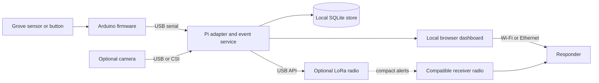

# A three hour hardware crash course

Trace one observation from sensor to responder. These exercises are proposed, not run. Before hardware arrives, use the labeled [simulated event](../04-software/starter/examples/event.example.json).

## 0–20 minutes: understand the system

A **sensor** measures something. A **microcontroller** reads it on a predictable loop and can operate simple outputs. The **Raspberry Pi** runs Linux applications, handles larger data, stores events and hosts the interface. A **radio/network** moves information between locations. An **actuator** changes something: light, sound or motion. Every part needs suitable power.



An observation such as “24 °C” is not a hazard determination. A model prediction such as “possible person” is not a confirmed survivor. Preserve the evidence and let the interface distinguish observations, alerts and human review. See [Pi interfaces](https://www.raspberrypi.com/documentation/computers/raspberry-pi.html) and [SQLite's embedded use](https://sqlite.org/whentouse.html).

**Exercise:** identify what still works when the radio stops.

## 20–45 minutes: connect things correctly

| Interface | Plain meaning | Typical use |
|---|---|---|
| GPIO | Programmable high/low pins | Button, LED or interrupt signal |
| Analog + ADC | Variable voltage converted into a number | Some environmental sensors; use controller ADC or an external ADC |
| I2C | Addressed devices share data/clock wires | Multiple nearby sensors; address conflicts and voltage still matter |
| SPI | Clocked peripheral link with chip-select signals | Radios, fast sensors and displays |
| UART | Bytes sent with agreed timing/baud rate | Sensor stream or debug console |
| USB serial | USB device exposed as a serial stream | Convenient Arduino-to-Pi or laptop connection |
| PWM | Pulses with controlled timing/duty cycle | Servo commands or motor-driver control |
| CSI | Dedicated camera connection | Supported Pi camera and correct ribbon |
| PCIe | High-speed peripheral link | Compatible Pi accelerator |
| Ethernet | Wired local network | Reliable setup, dashboard or debugging link |

A driver translates device-specific behavior into software calls; an SDK packages APIs, examples and tools. A matching connector alone does not supply either. Grove simplifies wiring but still has distinct analog, digital, I2C and UART ports. [Grove interfaces](https://wiki.seeedstudio.com/Grove_System/)

Check supply voltage, signal voltage, pinout, grounding and current before connecting. Pi inputs cannot accept 5 V logic. A motor needs a driver and adequate power, not a GPIO power source. Batteries must support the actual output mode and load; printed capacity alone is not runtime. [Pi electrical guidance](https://www.raspberrypi.com/documentation/computers/raspberry-pi.html), [motor-driver example](https://learn.adafruit.com/adafruit-raspberry-pi-lesson-9-controlling-a-dc-motor?view=all)

**Exercise:** run one module's raw-reading example in the serial monitor; without hardware, identify missing model/voltage details.

## 45–75 minutes: turn readings into records

Firmware can send one JSON record per line over USB serial. A Python adapter parses it, checks units and validity, adds receipt time, and writes it to a local store. Treat malformed input as an error to display, not a zero reading. pySerial provides the serial connection; SQLite provides local persistence. [pySerial](https://github.com/pyserial/pyserial), [SQLite](https://sqlite.org/whentouse.html)

This compact teaching example is **simulated**, not the final schema:

```json
{
  "id": "simulated-temperature-001",
  "observed_at": "2026-10-29T12:00:00Z",
  "source": "simulated-node-01",
  "type": "temperature_observation",
  "measurement": {"value": 24.0, "unit": "degC"},
  "location": null,
  "simulated": true
}
```

The [repository example](../04-software/starter/examples/event.example.json) provides a more explicit draft with location uncertainty fields. Agree on one contract before implementing adapters. Unknown location stays unknown; no model confidence is invented for an ordinary temperature measurement.

For outages, add stable IDs, source sequence, observation time, receipt time and clock-quality information. Persist an outgoing queue, retry with bounded backoff and deduplicate at the receiver. “Delivered to a process” and “reviewed by a responder” are separate states.

**Exercise:** parse the sample, store it, restart, then replay it twice. The intended result is one retained observation with a clearly simulated label. Add a malformed sample and a disconnected source; neither should look healthy.

## 75–105 minutes: make a local network work offline

Wi-Fi connects nearby devices; Internet is an optional route beyond that network. A Pi can serve a browser dashboard over a suitable local access point or Ethernet. A lost venue router is different from a lost Internet uplink, so define the outage you plan to survive. Hotspot support depends on adapter and driver. [NetworkManager](https://networkmanager.pages.freedesktop.org/NetworkManager/NetworkManager/nmcli.html)

MQTT is optional publish/subscribe plumbing: adapters publish to named topics, a local broker routes messages, and consumers subscribe. Mosquitto can be that broker. It is useful once several processes need the same events; one process can start without it. Broker persistence is configurable and is not a substitute for the incident database or human acknowledgment. [Mosquitto](https://mosquitto.org/), [persistence settings](https://mosquitto.org/man/mosquitto-conf-5.html)

An offline page must have local JavaScript, CSS, fonts, images and other assets. An offline map additionally needs its style, sprites, glyphs and licensed geographic tiles. A MapLibre install alone does not provide those. [PMTiles and MapLibre](https://docs.protomaps.com/pmtiles/maplibre)

**Exercise:** load the interface from a fresh browser session with upstream Internet removed. If mapping is selected, pan and zoom beyond the initially displayed area. Check for hidden remote requests and missing assets.

## 105–135 minutes: choose what crosses the radio

| Technology | What it supplies | Good role in this project |
|---|---|---|
| Wi-Fi | Local IP network, relatively high data capacity | Images, web UI and nearby control |
| Bluetooth/BLE | Nearby device link | Setup or client-to-radio connection |
| LoRa | Low-rate radio modulation | Compact observations/alerts between compatible radios |
| LoRaWAN | Network architecture using gateways/server above LoRa | Only if the required local infrastructure is available |
| Meshtastic | Off-grid messaging software on supported LoRa devices | Ready-made small-message network; not LoRaWAN |
| UWB | Precise ranging/positioning methods | Tagged assets/responders and configured anchors |

A normal ESP32 or laptop is not a LoRa transceiver. Meshtastic needs supported radio hardware and matching configuration. Its published Long Fast theoretical rate is 1.07 kbps before headers, relaying and retransmissions; that explains why photos belong on local storage/Wi-Fi while radio packets carry short alerts. Do not treat that rate or advertised range records as expected field performance. [Supported devices](https://meshtastic.org/docs/hardware/devices/), [radio settings](https://meshtastic.org/docs/overview/radio-settings/), [LoRa layer](https://www.semtech.com/lora/what-is-lora)

**Exercise:** compare alert/image sizes. Measure radio latency if hardware exists; otherwise simulate delayed delivery.

## 135–160 minutes: separate seeing from locating

A camera detects image content. A depth camera or LiDAR estimates distance/geometry. Thermal sees emitted infrared contrast, not through walls. NoIR captures near-infrared light and is a different technology. AI inference executes a trained model; the accelerator only helps models/operators it supports. TOPS alone cannot predict complete application speed. [Thermal limits](https://www.flir.com/en-gb/discover/home-outdoor/can-thermal-imaging-see-through-walls/), [AI hardware](https://www.raspberrypi.com/documentation/accessories/ai-hat-plus.html)

GNSS locates its receiver. UWB ranges between participating devices and needs appropriate geometry for position. An IMU estimates motion/orientation but drifts when used for dead reckoning. To infer a detected person's map coordinate, you additionally need calibrated geometry, sensor pose, distance and uncertainty; do not put the node's coordinate on the person by accident. [GPS](https://www.gps.gov/gps-accuracy-0), [Qorvo UWB](https://www.qorvo.com/products/wireless-connectivity/ultra-wideband), [inertial drift](https://rotations.berkeley.edu/strapdown-inertial-navigation/)

**Exercise:** label each location's subject, source, age and uncertainty; define the human review step.

## 160–180 minutes: rehearse failures

Unplug the sensor, stop/restart the application, interrupt the link and remove Internet. Expected behaviors should be explicit: stale status, retained events, no duplicate incidents, honest timestamps, and visible acknowledgment. For a moving robot, also define the stop behavior when commands disappear. Record observed results separately from this proposed checklist.

## Terms to recognize

**Firmware:** program flashed onto a controller. **Inference:** running a trained model. **Edge AI:** inference at the device. **Sensor fusion:** combining measurements with timing/geometry assumptions. **Point cloud:** measured 3D points. **SLAM:** estimating motion while building a map. **Calibration:** estimating how readings relate to reference measurements. **SDK:** vendor tools/APIs/examples. **Telemetry:** reported device state. **Latency:** elapsed time through a path. **Throughput:** useful data carried per unit time. **Provenance:** where an observation came from.
