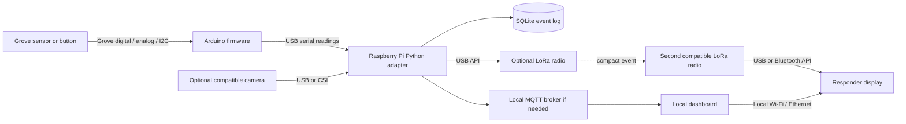

# Offline communications and integration readiness

Research date: 2026-10-29. Sources below were inspected live. This is documentary research, not a hardware test, range measurement, installed-software inventory, or production readiness assessment. The organizer's two-page equipment list specifies categories, not exact shared-device models. Priority scores below are recommendations for this hackathon, not vendor claims.

## How do the radios, sensing, computers and responders fit together?

### Takeaway
Build a small local system first: a sensor feeds the Arduino, USB carries readings to the Raspberry Pi, and the Pi stores events and serves a dashboard. Add LoRa only for compact alerts when a compatible pair of radios is available; keep video and other large data on the Pi or local Wi-Fi.

### Cited Findings
- Raspberry Pi single-board computers run Linux and support USB and GPIO; microcontrollers instead run firmware directly. The board documentation distinguishes these roles and describes the available hardware interfaces. [Raspberry Pi hardware](https://www.raspberrypi.com/documentation/computers/raspberry-pi.html)
- LoRa is the radio modulation/physical layer. LoRaWAN is a separate interoperability standard above it; a LoRa radio can support other protocols depending on its hardware and firmware. Therefore "LoRa" alone does not identify the application network. [Semtech LoRa explanation](https://www.semtech.com/lora/what-is-lora)
- Meshtastic is explicitly not LoRaWAN, Helium or The Things Network; matching the LoRa physical radio alone does not make these systems interoperate. [Meshtastic radio settings](https://meshtastic.org/docs/overview/radio-settings/)
- IMU-based dead reckoning accumulates integration error: acceleration and orientation errors grow into position drift. External position/orientation references can constrain it; an IMU is not a standalone accurate indoor GPS replacement. [UC Berkeley inertial-navigation explanation](https://rotations.berkeley.edu/strapdown-inertial-navigation/)
- Meshtastic is an open-source, off-grid system that carries text and position reports over LoRa. Its nodes relay packets, and nodes must agree on radio parameters. Channel names and keys are another configuration layer. Its standard channel key is publicly known, so a default channel is not a private team channel. [Meshtastic overview](https://meshtastic.org/docs/overview/)
- A Meshtastic client reaches its radio over USB/serial, Bluetooth, or TCP depending on device capabilities. Python tooling can inspect the radio configuration and consume packets. This does not make a laptop or ordinary ESP32 a LoRa radio: a supported LoRa transceiver/board is still required. [Python CLI](https://meshtastic.org/docs/software/python/cli/); [supported hardware](https://meshtastic.org/docs/hardware/devices/)
- Meshtastic's Long Fast preset has a published theoretical rate of 1.07 kbps. The table explicitly excludes headers, relays and retransmissions. Different presets trade rate against link budget; advertised distance records are not expected disaster-site range. [Radio settings](https://meshtastic.org/docs/overview/radio-settings/)
- MQTT uses a publish/subscribe model: devices publish to topics, and interested applications receive those topics through a broker. Mosquitto is a lightweight broker suitable for a single-board computer and includes command-line publish/subscribe clients. A broker can run locally; cloud hosting is not intrinsic to MQTT. [Mosquitto project](https://mosquitto.org/)
- Broker persistence is configurable and defaults to off in the inspected Mosquitto configuration reference. Persistence saves session/message state, but this is not an application incident database. Use a separate durable event record for restart/replay and acknowledgments. [Mosquitto configuration](https://mosquitto.org/man/mosquitto-conf-5.html)
- SQLite is designed for local application/device storage and is a strong fit for embedded deployments. It does not require a separate database server. [Appropriate uses of SQLite](https://sqlite.org/whentouse.html)
- A local Wi-Fi network can expose the Pi's web interface and SSH without an internet connection. NetworkManager supports an access-point/hotspot profile when the Wi-Fi device and driver support it; confirm WPA rather than accept a weaker fallback. Raspberry Pi documents local-network SSH access. [NetworkManager reference](https://networkmanager.pages.freedesktop.org/NetworkManager/NetworkManager/nmcli.html); [Raspberry Pi remote access](https://www.raspberrypi.com/documentation/computers/remote-access.html)
- GPS/GNSS reports the receiver's position, not the position of every person it can see. Building obstruction, indoor/underground use and reflected signals degrade GPS fixes. The official archived GPS accuracy page is older (content frozen since February 2025), but these physical limitations remain applicable; it does not establish the accuracy of the supplied receivers. [GPS.gov accuracy](https://archive.gps.gov/systems/gps/performance/accuracy/)
- UWB devices can support two-way ranging (distance between compatible radios), time-difference positioning, or angle-of-arrival depending on the kit. A ranging measurement is not automatically a complete building-coordinate position. Qorvo distinguishes these configurations and supplies model-specific SDKs and examples. [Qorvo UWB products and development resources](https://www.qorvo.com/products/wireless-connectivity/ultra-wideband)
- GPSD reads supported serial/USB GNSS receivers and makes position data accessible to multiple client applications; it includes diagnostic/replay tooling and Python/C/C++ interfaces. [GPSD project](https://gpsd.io/)
- GNU Radio offers signal-processing blocks for software-defined radios and can run with simulated signals before an SDR is available. It is a toolkit for constructing a radio pipeline, not a universal decoder or ready-made responder communication application. [GNU Radio explanation](https://www.gnuradio.org/about/)
- Meshtastic's MQTT module is a configurable bridge. Its public documentation emphasizes internet bridges, which must not become a hidden dependency in an offline demo. A USB Python-to-local-broker bridge is a simpler explicit local architecture. [Meshtastic MQTT module](https://meshtastic.org/docs/configuration/module/mqtt/)

### Inferences
Recommended architecture, contingent on the actual board/module interfaces:

Plain-language crash-course vocabulary:

| Concept | Meaning in the project | Practical implication |
|---|---|---|
| Sensor | Converts a physical property into a reading | A reading needs units, timestamp, sensor ID and a validity flag |
| Actuator | Changes the physical world: light, sound, motor | Use appropriate driver/power circuitry; commands should fail to a safe idle state |
| Firmware | The program flashed onto a microcontroller | Arduino C/C++ handles sampling and simple outputs |
| Edge compute | Processing on the Pi beside the sensors | Network outage does not stop local inference or logging |
| GPIO / digital | Pins that read or set high/low states | Check logic voltage and pin assignment |
| Analog / ADC | Variable voltage and its conversion into numbers | Do not assume every computer pin measures analog voltage |
| I2C | Short-distance bus for addressed sensors | Check voltage, addresses and library support; same connector is not a complete compatibility guarantee |
| SPI | Fast short-distance peripheral bus with chip-select lines | Common for radio modules and other peripherals; wiring/driver must match |
| UART / serial | A stream of bytes with agreed settings | Baud rate and message framing must match; USB serial is a convenient first integration |
| CSI / USB camera | Camera connection and driver path | Mechanical connector and operating-system driver both need to fit |
| MQTT topic | A named message stream such as `teamA/events` | Separate sensor production from dashboard consumption |
| Wi-Fi / internet | Wi-Fi is a local radio network; internet is optional upstream connectivity | Prove the demo with the upstream disconnected |
| BLE / LoRa | BLE connects nearby clients to devices; LoRa carries small packets over a different radio link | A BLE connection does not itself provide LoRa range |
| GNSS / UWB / IMU | Global receiver fix / relative radio ranging / motion-orientation sensing | None alone guarantees an indoor person's exact position |
| Detection / localization | "Something was observed" versus "where it is" | Camera detection at a node is evidence near that node, not a surveyed target coordinate |
| Acknowledgment | Evidence that an event was received or reviewed | Keep transport delivery and responder review as separate states |

The vocabulary is an educational synthesis of the referenced vendor/project documentation; exact electrical/interface compatibility must be established from the allocated module datasheets.

Practical design recommendations:
- Send a short record containing event ID, source node, sequence, observed time, location source/uncertainty, event type, severity/confidence, and battery/health. Store larger evidence locally and reference it by ID. For LoRa, compact or encode the record; verbose JSON is a convenient local interchange but may exceed the radio's application payload limit.
- Use `observed_at`, `received_at`, and an increasing sequence. Without an internet time source, clocks can disagree; show time-quality or relative age. A stale map pin must not look like a fresh observation.
- Keep an application outbox on disk, retry with bounded backoff, deduplicate by event ID, and expire stale alerts. MQTT QoS alone cannot prove a responder saw an alert or make an offline radio queue durable.
- Maintain two paths: local detailed evidence over USB/Wi-Fi, compact alert over LoRa. A relay increases reach only when topology, radio settings, power and congestion permit it.
- Start with USB serial between Arduino and Pi to avoid direct 3.3 V/5 V signal wiring. Check the actual Grove board/module voltage; do not connect a 5 V sensor output to a Pi input by assumption. Motors need a driver and an appropriate supply; battery runtime must be measured with the actual load.
- Baseline fallback needs no shared robot, drone, thermal camera or radio: a manually marked node location, a supplied sensor/button, and a local list/map dashboard are enough for an honest end-to-end demo.

### Gaps
- The exact Grove modules, Arduino-compatible board, LoRa/UWB/SDR/GNSS models, antenna bands, firmware, number of paired radios, drivers and battery capacities are unknown.
- No range, throughput, latency, radio legal configuration, battery endurance, sensor calibration, indoor localization accuracy or detection accuracy has been measured.
- UWB coordinate tracking needs an agreed coordinate frame and appropriate anchors/geometry (or a supported angle-based scheme), plus calibration. A random pair of UWB boards should only be promised as a ranging experiment.
- Local hotspot operation and simultaneous uplink/client mode depend on adapter/driver configuration. Keep an Ethernet/USB or dedicated-access-point fallback rather than assume one Wi-Fi interface can do everything.

## Which integration software should be ready before arrival?

### Takeaway
Prepare one small data path, then cache conditional tools for the selected extension. Highest value is Python with local storage, a serial adapter, and a local browser display. Add Mosquitto when several processes/devices need messaging; use Node-RED as an alternative quick integration surface, not a compulsory extra application stack.

### Cited Findings
| Priority recommendation | Tool / upstream | Why and where it fits | Platform / language / licensing evidence | Before-arrival action and smoke test |
|---|---|---|---|---|
| P0: essential concept; no separate server | [SQLite](https://sqlite.org/whentouse.html) | Durable local events, retry queue and replay | Embedded C engine; available through Python's sqlite3; core public domain [copyright](https://sqlite.org/copyright.html) | Make a small event DB on Mac; restart writer and reader and verify the events survive |
| P1: high value for multiple modules | [Eclipse Mosquitto](https://github.com/eclipse-mosquitto/mosquitto) | Broker decouples firmware adapters, inference and dashboard | EPL/EDL open source; Mac Homebrew, Linux/Pi packages [download](https://mosquitto.org/download/); publisher/subscriber included [overview](https://mosquitto.org/) | Download/install on chosen host before event; publish one synthetic event and receive it while offline; explicit local listener/auth configuration when exposing beyond localhost |
| P1 if using MQTT | [Eclipse Paho Python](https://github.com/eclipse-paho/paho.mqtt.python) | Python MQTT client for Pi bridge and desktop simulator | Python 3.9+ per README; release 2.0 changed callbacks; repository includes EPL2/EDL1 license files | Use the current callback API from README; do not paste old tutorials unmodified. Prove disconnect/reconnect, dedupe and application restart |
| P1 alternative UI path | [Node-RED](https://github.com/node-red/node-red) | Visual wiring for MQTT, JSON transformations and local UI endpoints | Apache-2.0; Node.js/JavaScript; [Mac/local guide](https://nodered.org/docs/getting-started/local), [Pi guide](https://nodered.org/docs/getting-started/raspberrypi) | Use if speed of wiring matters more than custom UI. Export flows to the repo. Prove an injected event reaches a debug node and selected local UI |
| P1 only with Node-RED UI choice | [FlowFuse Dashboard](https://github.com/FlowFuse/node-red-dashboard) | Maintained dashboard widgets for Node-RED | Apache-2.0; HTML/JavaScript/Vue customization; [docs](https://dashboard.flowfuse.com/) | Prefer this current successor over tutorials based on old AngularJS Node-RED Dashboard. Cache chosen nodes, no cloud account required for local package use |
| P1 if a map improves the demo | [MapLibre GL JS](https://github.com/maplibre/maplibre-gl-js) + [PMTiles](https://github.com/protomaps/PMTiles) | Local map display and compact geographic tile archive | TypeScript/JavaScript browser library, BSD-3-Clause; PMTiles reference implementations BSD-3-Clause, format CC0/public domain | Bundle map JS/CSS, style JSON, fonts, sprites and licensed regional tile data. Serve locally with HTTP Range support. Disconnect internet and pan/zoom outside the initial viewport [local serving](https://docs.protomaps.com/pmtiles/), [MapLibre setup](https://docs.protomaps.com/pmtiles/maplibre) |
| P1 if compatible paired LoRa devices confirmed | [Meshtastic firmware](https://github.com/meshtastic/firmware), [Python client](https://github.com/meshtastic/python) | Existing off-grid messaging protocol avoids writing an RF stack | Both repos GPL-3.0; firmware C/C++, client Python. Supported boards only [hardware](https://meshtastic.org/docs/hardware/devices/) | Cache correct stable firmware for actual board, not latest development branch; install CLI in a virtual environment. Read config, match region/modem/channel, then exchange uniquely identified test messages |
| P2 if GNSS chosen | [GPSD](https://gpsd.io/) | Share supported USB/serial receiver data and replay logs | Primarily target Linux; C service with Python/C/C++ bindings; [installation guidance](https://gpsd.io/installation.html) | Check receiver support, obtain a fix outdoors, display validity/fix age. License details should be checked in the selected release before redistribution; not independently pinned here |
| P2, usually skip first demo | [GNU Radio](https://github.com/gnuradio/gnuradio) | Build DSP/radio experiments, inspect RF signals | GPL-3.0; Python/C++ and graphical flowgraphs; host and device-driver packages depend on SDR | Prepare only if the idea itself needs RF/DSP and a teammate can own it. Run a synthetic signal flow before connecting radio. A basic spectrum display does not locate people |
| P2, only if responder integration is required | [TAK Server](https://github.com/TAK-Product-Center/Server) | Existing responder-oriented geospatial ecosystem; potential external display integration | Official repository; README specifies Java 17 plus PostgreSQL/PostGIS and certificate configuration; Linux/Mac development. License and third-party notices need review | First ask organizers whether a known TAK environment/client is available. Avoid building a full server before a functional local prototype. A CoT/TAK bridge requires protocol and receiver verification |
| Already part of supported target OS | [NetworkManager/nmcli](https://networkmanager.pages.freedesktop.org/NetworkManager/NetworkManager/nmcli.html) | Local IP configuration and supported hotspot mode | Linux system networking; shell commands rather than application code | Save local IP/SSID connection instructions; prove local access after upstream internet is removed |

- Current Node-RED guidance inspected on 2026-10-29 recommends Node 24.x. It lists Node-RED 5.x minimum Node 22 and Node-RED 4.x minimum Node 18. This is a reason to check the chosen Node-RED release rather than copy old Node 18 installation recipes. Third-party nodes may have their own requirements. [Node-RED Node versions](https://nodered.org/docs/faq/node-versions)
- The Node-RED editor is unsecured by default; anyone reaching it can deploy flows. Keep development editor local or explicitly configure authentication when using a shared hackathon network. [Node-RED security guide](https://nodered.org/docs/user-guide/runtime/securing-node-red)
- The official PMTiles example uses HTTP range reads. Downloading a PMTiles file does not automatically remove the map's remote fonts, style, sprite or JS dependencies. The architecture should make every dependency local and test from a clean browser load. [PMTiles concepts](https://docs.protomaps.com/pmtiles/); [MapLibre integration](https://docs.protomaps.com/pmtiles/maplibre)

### Inferences
Recommended language allocation: Python for device adapters, event handling and local services; Arduino C/C++ for firmware; JavaScript/TypeScript only for a custom web map or Node-RED functions. Learn the data flow and serial/MQTT messages before learning ROS, DSP, Rust or a new drone stack.

Minimal software selection: Python + serial library + SQLite + simple browser UI. Add Mosquitto/Paho if the team has multiple producers or consumers. Choose either a lightweight custom dashboard or Node-RED/FlowFuse for the first slice; do not maintain both without a reason. MapLibre/PMTiles and Meshtastic are extensions. GPSD is conditional. GNU Radio and TAK Server should usually wait.

Trust indicators are upstream ownership, public source, explicit licenses, maintained documentation, and hardware support tables—not star counts. Record an actual tested version/commit once installed. No release was installed or pinned during this research. GPL licenses on firmware/client code and independent licenses on maps/assets still matter when publishing; a permissive dashboard library does not grant rights to arbitrary map tiles.

### Gaps
- Availability in an upstream download page is not a successful install on the user's laptop; no installations were performed.
- No universal tested dependency lock can be supplied before the team chooses hardware, operating systems and the UI path. Cache architecture-specific Python wheels/native packages for the actual target: Mac packages do not become Pi Linux packages just because both machines use ARM.
- The exact TAK client/server version and any integration permissions are unknown. Do not promise existing responder-system compatibility until a real test receiver accepts the event.

## What should the team learn, build and prove first?

### Takeaway
The strongest first demonstration is an event that stays useful through an outage: observed, timestamped, stored, delivered when possible, and visibly acknowledged. A smaller reliable pipeline tells a clearer story than many sensors with no proven connection to a responder.

### Cited Findings
- The baseline hardware and shared-hardware distinction comes directly from the organizer's attached list: every team receives Pi 5 with accelerator, Arduino-compatible board/Grove shield, Grove 40-in-1 kit, storage/power/development accessories; cameras, special radios, robots and drones are shared checkout items. [Saved organizer PDF](../../../02-equipment/source/Hackathon%20Hardware%20Details.pdf)
- Off-grid compact messaging is supported by Meshtastic, but it is tied to supported device configurations. [Meshtastic introduction](https://meshtastic.org/docs/introduction/); [hardware](https://meshtastic.org/docs/hardware/devices/)
- Local map archives and local message/storage components provide building blocks for a disconnected application; they do not automatically create an outage-tested end-to-end system. [PMTiles](https://docs.protomaps.com/pmtiles/); [SQLite](https://sqlite.org/whentouse.html)

### Inferences
All project ideas and test criteria below are proposed directions, not confirmed decisions or measured capabilities.

| Idea | What the demo does | Hardware dependency | Fallback | Proposed acceptance test |
|---|---|---|---|---|
| 1. Offline incident board | Sensor/button events become a prioritized local incident list with source, age, location label and acknowledgment | Baseline only, after confirming at least one suitable Grove input; manual event button in software if no matching module | Synthetic data clearly labeled | Disconnect internet, generate ten events, restart service, recover all ten without duplicates, show acknowledgment and stale-node state |
| 2. Hazard breadcrumb nodes | Drop a sensor node at a location; changes generate an alert to a responder station | Baseline sensor adapter; remote extension needs two compatible LoRa radios and suitable power | USB/local Wi-Fi cable-scale demo | Trigger a benign test change, retain unsent event during disconnect, deliver once after reconnect and show observation age. Avoid interpreting an uncalibrated gas reading as "safe" |
| 3. Human presence review station | Camera inference proposes a possible person; responder reviews evidence and dismisses false alarms | Shared compatible camera; accelerator model/runtime compatibility; optional thermal | Saved footage with consent, labeled replay; CPU path | Use a fixed positive/negative demo set, report misses and false positives, send only an event summary; do not equate "no detection" with "no person" |
| 4. Team location and last contact | Show a consenting teammate's last GNSS fix, message, acknowledgment and stale status | Shared GNSS plus suitable paired LoRa; outdoors for receiver test | Manual location markers | Move between known points outdoors, record actual error/latency, unplug node and show stale location. Indoor UWB ranging is a separate extension needing compatible kit/anchors |
| 5. Teleoperated inspection scout | Operator drives a robot to inspect a point; video stays local, hazard/event note reaches dashboard | Shared robot, controller, battery and camera with working SDK | Stationary pan-tilt camera or handheld sensor | Demonstrate operator control, explicit stop on lost connection, and a marked observation. Defer autonomous navigation and drones unless team already has a working platform |

Proposed three-hour crash course:
1. **0–20 min: architecture.** Label physical sensor, firmware, Pi process, transport, database and responder screen. Trace a single observation through the diagram; distinguish a raw reading, an alert and a reviewed incident.
2. **20–45 min: simple hardware I/O.** Identify voltage and port type from actual datasheets. Flash the board's provided basic example; read a button/sensor with a serial monitor. Learn what changes when a sensor disconnects.
3. **45–75 min: serial-to-event bridge.** Parse one line, attach source/sequence/time/units, store it locally, replay it. Deliberately feed malformed input and a duplicate record.
4. **75–105 min: local networking.** Serve a page on Pi or laptop; reach it from a second device on the same LAN. If MQTT is selected, publish/subscribe to one topic. Remove upstream internet and repeat from a fresh page load.
5. **105–135 min: transport tradeoffs.** Compare a short incident record with a photo. Explain why the latter belongs on Wi-Fi/local storage. If LoRa radios exist, send one small message and measure latency rather than claim a range.
6. **135–160 min: location and evidence.** Annotate whether a location is sensor location, manually supplied, GNSS, or UWB. Add fix age/uncertainty and review state. Do not draw a precise victim pin from camera detection alone.
7. **160–180 min: failure rehearsal.** Unplug sensor, restart process, interrupt connection, reload browser without internet. Score recovery, duplicates, stale labels and acknowledgment separately.

Before-arrival preflight recommendations:
- Ask organizers for model/SKU and links for board, Grove kit, accelerator, camera, LoRa, UWB and robot; exact preinstalled OS image and credentials handoff; whether shared hardware can be reserved; available power/cables and local network constraints.
- Ask whether offline operation means no internet, no venue Wi-Fi, no cellular, or all three. Plan to own a local link and test it.
- Agree with teammates on one common event schema, topic names, coordinate conventions, units and ownership of each adapter.
- Save docs, working example source, model files, target-specific dependency packages, selected OS image and correct firmware locally. Clone only the tools selected for the project and record commits/licenses; download archive hashes where upstream publishes them.
- Bring known data-capable USB cables, needed USB-C/A adapters, Ethernet option, card reader if flashing is needed, and labeled power accessories; verify exact connector sizes before depending on them.
- Prepare an offline synthetic/replay dataset and label it in the UI. It keeps development moving if shared hardware is unavailable without pretending to be a hardware demonstration.
- Budget first hour at the event for inventory and one sensor reading; second hour for a complete local path; only then add the special camera/radio/robot extension.

### Gaps
The organizer has not supplied an exact date/time, network rules, API restrictions, team experience, judging rubric or detailed device SKUs. A precise installation bill and performance target should be refined when those facts arrive. These notes do not assert actual sensor or emergency-response validation.
