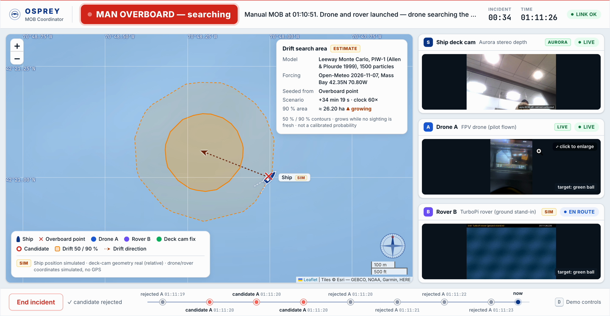

# Osprey — man-overboard response under degraded comms

Team 29, CodeMetal Forge 2026.

**Landing page:** [`index.html`](index.html) runs the 3D mission simulation in the page, with the recorded Osprey MOB Coordinator run below it. Serve the repo root to view it locally: `python3 -m http.server 8088 --bind 127.0.0.1`, then open `http://127.0.0.1:8088/`.

### Mission simulation (concept)

Interactive, runs in the browser: [`simulation/`](simulation/README.md). Scripted sightings, illustrative vehicles, compressed scenario time.

### Osprey MOB Coordinator (recorded run)

[](docs/media/coordinator.mp4)

Click the still for the 91 s screen recording. Items marked SIM are simulated; the drift area is an estimate.

A ship's deck camera sees someone go over the rail and declares **man overboard** automatically. Two scout nodes (stand-ins for drones) search, the coordinator confirms the person, and the scouts lock on and follow. When comms drop or the person slips out of view, the coordinator's picture degrades honestly: last evidence with a ticking age, then a drift-driven search area. When contact returns, the picture recovers without stale data overwriting fresh data.

| | |
|---|---|
| Ship deck camera | Deptrum Aurora 930 RGB-D: rail-crossing trigger and real relative position |
| Ground processor | Raspberry Pi 5 + Hailo-8 person detection |
| Scout A | Hiwonder TurboPi rover with a pan-tilt camera that follows the person (ground stand-in for a drone) |
| Scout B | Phone camera through an HTTPS tunnel (proxy for a second drone) |
| Coordinator | Browser display on a laptop, wired to the ground processor |

## Two independent features

| Feature | Location | Purpose | Run |
|---|---|---|---|
| Operational coordinator UI | `web/` + `src/osprey/` | Camera feeds, incidents, drift estimates and hardware coordination | Existing Pi/server workflow below |
| 3D mission simulation | [`simulation/`](simulation/README.md) | Standalone narrated product-vision demonstration with scripted sightings | `python3 -m http.server 8087 --bind 127.0.0.1 --directory simulation`, then open `http://127.0.0.1:8087/` |

The simulation has no live coordinator or hardware connection. Its bundled data and graphics run independently; its optional fixture generator reuses the repository's drift model. See [simulation research and assumptions](simulation/RESEARCH.md).

## Docs

- [PRD](docs/prd.md): story, requirements, targets, honesty labels
- [Implementation plan](docs/implementation-plan.md): architecture, contracts, phases
- [Hardware state](docs/hardware.md): what has been verified
- [Hardware setup](docs/hardware-setup.md): bring-up steps for the team
- [Research](docs/research.md) · [Event constraints](docs/event-constraints.md)

## Run the operational coordinator

For the operational coordinator, everything runs on the Pi; the Mac only edits, deploys and displays. From the Mac, in this repo:

```bash
python3 -m venv .venv && .venv/bin/pip install -e '.[dev]'
```

```bash
.venv/bin/pytest -q
```

```bash
scripts/deploy.sh --restart
```

Then open `http://169.254.50.2:8000` on the Mac (wired link). Press **D** for the demo drawer.

Play the whole story with simulated feeds and check every phase (prints a timing table):

```bash
.venv/bin/python scripts/sim_story.py http://169.254.50.2:8000
```

Control from the terminal (`state`, `demo_start`, `confirm`, `end_incident`, `set_rail rail_m=1.6`, …):

```bash
.venv/bin/python scripts/ctl.py state
```

Real hardware:

| Piece | Command |
|---|---|
| Hardware check on the Pi | `ssh mob-pi 'cd ~/osprey && python3 scripts/check_hardware.py'` |
| Build the Aurora bridge (once, on the Pi) | `ssh mob-pi '~/osprey/native/aurora/build.sh'` |
| Deck camera on | `.venv/bin/python scripts/ctl.py demo_source node=ship source=aurora` (or `source_ship: aurora` in `config.yaml`) |
| Calibrate the rail | stand on the tape, read `curl -s 169.254.50.2:8000/api/calibration`, then `scripts/ctl.py set_rail rail_m=<z>` |
| Drone video (Scout A) | plug the 5.8 GHz USB receiver into the Pi, check `curl -s 169.254.50.2:8000/api/video_devices`, then `scripts/ctl.py demo_source node=A source=usb` (recorded fallback: `capture_file` in `config.yaml`, `source=file`) |
| Tunnel for the rover/phone | `ssh mob-pi '~/osprey/scripts/tunnel.sh'` prints the URL |
| Rover (Scout B) on the TurboPi | `python3 scout_client.py <tunnel URL> --node B --hw hiwonder` (hardware calls filled in at H3) |
| Phone (fallback scout) | open `<tunnel URL>/scout` on the phone |
| Measure outage recovery | `.venv/bin/python scripts/measure_outage.py --inject 5` (or `--watch 60` and pull the cable) |
| Server log | `ssh mob-pi '~/osprey/scripts/run_pi.sh log'` |

Settings live in `src/osprey/config.py`; override them in `config.yaml` at the repo root or with `OSPREY_<NAME>` environment variables. Measured numbers are in [docs/results.md](docs/results.md); the run order for judges is in [docs/demo-script.md](docs/demo-script.md).

## Status

Done: the fully simulated demo (Phase 2), the real deck-camera pipeline (Aurora + Hailo at ~14 fps), the phone scout page and ingest, outage injection and recovery, and drift with published PIW leeway coefficients. Drift uses an Open-Meteo Massachusetts Bay snapshot (Nov 7). Pending: rail calibration on the mounted camera, the tunnel test with the phone, and the TurboPi client.

## Licensing

Apache-2.0. Third-party SDKs, models and data keep their own licenses: the Deptrum SDK is not redistributed here, and Hailo models are installed from Raspberry Pi OS packages.
