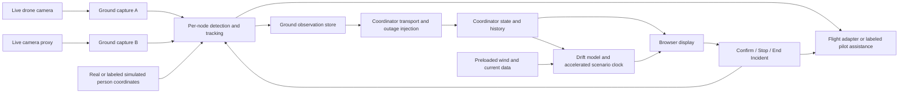

# System boundaries and interfaces

Implementation baseline derived from the accepted PRD. Interface details below are engineering design recommendations to verify during implementation.

## Deployment and data paths

One repository contains a Python backend and browser coordinator display. Ground processing can run on the supplied Pi with the coordinator service/display on a laptop. Two independently identified logical sensor nodes may share a processor. Hardware adapters are chosen after checkout.

Live media follows a streaming path from ground capture to the coordinator, alongside observation messages. The coordinator-outage injector covers media and state delivery. It leaves camera inputs, processing, retained observations and aircraft control intact. Aircraft-control or video-input loss is a separate failure case.

The coordinator can only display received evidence. It must not use ground-side state through a shared database or hidden endpoint during the demonstrated outage. Retain a local display snapshot and age it locally. Show an unavailable command path when commands cannot reach the ground service. Pilot control remains independently available.

## State ownership

- Capture adapters timestamp frames and expose stream health, frame identity and actual modality.
- Each node maintains its own candidates, active track and retained accepted sighting.
- Incident state owns initial target confirmation and cross-node identity association.
- Flight integration consumes accepted target state and responds to stop, visual loss, operator override and aircraft failsafe.
- Ground storage persists observations during coordinator disconnection.
- Coordinator state validates and orders received observations before updating the display.
- Drift estimation uses the coordinator's latest accepted evidence, environmental inputs and a separate scenario clock.
- End Incident closes the incident and stops tracking/following. Late backlog can enter history but cannot reactivate a closed incident.

## Observation contract

| Field group | Required meaning |
| --- | --- |
| Identity | Schema version, incident ID, node ID, source-session ID, sequence, event ID |
| Capture time | Capture timestamp, frame ID, clock quality and clock domain |
| Delivery time | Send timestamp and receiver receipt timestamp |
| Association | Candidate/accepted target identity, track ID, confirmation state |
| Visual and input state | Observed/lost/candidate plus camera-input availability |
| Person location | Position, coordinate frame, units, quality, measurement time, real/simulated provenance |
| Evidence | Retained image reference, capture time, modality, live-input provenance |
| Mode | Autonomous or pilot-assisted flight, real/simulated positioning |
| History | Original observation identity and times preserved on retransmission |

Capture time determines sighting age. Heartbeats, duplicate delivery and a new image receipt must not rejuvenate an old sighting. Preserve both real timestamps and simulated scenario timestamps wherever the scenario needs a mapping.

Use a shared clock when possible. Otherwise measure source/receiver offset and bounds. A receiver timestamp is not a substitute for an unmeasured capture time. Flag degraded clock quality.

Use idempotent ingestion and a monotonic within-session sequence. Do not order across restarted sessions by sequence alone. Receiver policy must distinguish an authorized new source session from late packets belonging to an old one. Persist enough state to preserve current observation and incident identity across reconnect.

## Commands

Commands need incident ID, unique command ID, target node where applicable, requested action and explicit acknowledgment/result. Retrying confirmation or End Incident should have one effect. Stop/override takes priority over follow commands. Closing an incident invalidates queued follow requests. UI command success requires acknowledgment from the owning service.

Exact stop/override behavior and aircraft recovery are adapter-specific. Configure these with the flight operator before testing. Software stop delivery depends on connectivity. Pilot control and aircraft failsafe remain available under their verified hardware configuration.

## Association and geolocation

Apply the PRD's different reference points precisely. Reacquisition compares against the person's last location before that node lost visual contact. The second node's initial association compares against the most recent accepted person location. Use horizontal distance in meters, with 50 m included.

The implementation must flag unavailable or unreliable positions and require confirmation. Document coordinate uncertainty and multi-candidate behavior. Do not merge conflicting locations into an unexplained average.

For real projection, verify camera intrinsics, distortion, pose, time alignment and reference surface. Drone position alone does not locate the person. For simulated positions, use an explicit adapter and one scenario origin shared by both nodes. Keep simulated coordinates out of physical aircraft guidance. Real following requires validated live image/control inputs and aircraft positioning.

## Loss behavior

| Ground evidence / coordinator connectivity | Coordinator meaning |
| --- | --- |
| Fresh accepted detection received | Person observed at capture time |
| Heartbeat and live video, person absent | Visual contact lost |
| Healthy processing connection, camera frames unavailable | Visual-input loss |
| Processor unreachable from coordinator | Coordinator link lost, current remote visual state unknown |
| Delayed accepted observation | Historical evidence unless newer than current valid state |

The six-second sighting threshold and the link timeout are different settings. Choose and test a heartbeat/timeout pair that exposes the five-second outage. A separate numeric link-age display remains optional. Actual link status must be observable.

## Drift and clock boundaries

Use local metric coordinates for calculation and geographic coordinates at the map boundary. Select an explicit wind/current-driven model and document object/leeway parameters, uncertainty inputs and data provenance. OpenDrift is a candidate, subject to dependency and dataset readiness. Avoid double-counting environmental velocity already present in observed motion.

For a minimal two-node implementation, using the latest accepted observation as the prediction seed is an engineering recommendation. Keep per-node locations visible and document how conflicting or asynchronous observations are handled.

Freshness uses real capture age. At age greater than six seconds for both nodes, enable the estimate. Simulation speed advances only scenario integration time. Display the mapping, elapsed simulated time and multiplier. On new accepted evidence, explicitly reseed or suspend the estimate according to a documented policy. The hidden reference trajectory used for verification must never be an input to prediction.
