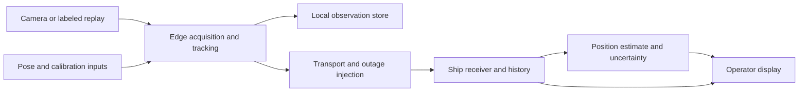

# System boundaries and interfaces

Status is proposed architecture pending PRD decisions.

## Data path

Use one repository and two logical runtime roles. For a hardware demo, the edge role can run on a Pi and the ship role on a laptop. Both can run as separate processes on one machine during development. Sharing code does not require independently deployed services for every box.

## Responsibilities

- Capture adapter timestamps frames at acquisition and exposes camera metadata.
- Perception identifies candidates and track associations in images.
- Localization converts image geometry to a specified coordinate frame when sufficient pose/calibration data exists.
- Edge storage retains original observations through link outages.
- Transport sends small state updates and image evidence according to the selected bandwidth budget.
- Receiver validates, deduplicates and stores packets before presenting current state.
- Estimation predicts from available evidence and records the assumptions used.
- Operator display presents observation age, link age, location quality and evidence independently.

Keep estimation independent of camera drivers and transport. Supply a deterministic replay clock so tests can reproduce outages and delayed arrivals.

## Proposed message contract

This is a design contract to resolve before encoding a schema.

| Field group | Required meaning |
| --- | --- |
| Identity | schema version, incident ID, source ID, source-session ID, sequence number |
| Time | observation/capture time, transmission time, clock quality/offset assumption; receiver adds receipt time |
| Contact | target/track ID, observed/candidate/lost state, association quality |
| Location | coordinate frame, position if known, reference origin, uncertainty representation and units |
| Evidence | image ID/reference, capture time, modality, live/replay/simulated provenance |
| Prediction | model/assumptions and prediction time, kept distinct from the original observation |

Unknown position remains unknown. The receiver must not substitute the aircraft location for the person. A packet receipt acknowledgment and an operator's confirmation have separate meanings.

Determine observation order within a source session using sequence and capture time. Persist duplicates idempotently. A new source-session identifier handles process restarts. Fresh state precedes historical backlog on reconnect. Late images retain their original timestamps.

Clock synchronization is part of the interface. Without a defensible offset bound, the UI must expose the timestamp limitation instead of reporting misleading precise age.

## Independent failure states

| Evidence at receiver | Display meaning |
| --- | --- |
| Fresh visual observation | Contact observed at capture time |
| Fresh heartbeat reporting visual loss | Node reachable, person currently unobserved |
| Missing recent messages | Link stale, current remote visual state unknown |
| Fresh observation after interruption | Update current contact |
| Old observation or image arrives | Historical evidence |
| Ambiguous candidate | Pending association or operator confirmation |

## Position estimation

Use local east/north coordinates in meters for short-range computation and convert to geographic coordinates at a defined boundary. A camera projection requires intrinsic calibration, distortion handling, camera pose, time alignment and an assumed surface. Near-horizontal rays and missing pose should fail explicitly.

A short-gap constant-velocity predictor is a candidate baseline. A wind/current model can generate scenarios or augment it when justified. Avoid double-counting current already contained in measured target velocity. Compare prediction to a fixed last-seen baseline under the same inputs.
